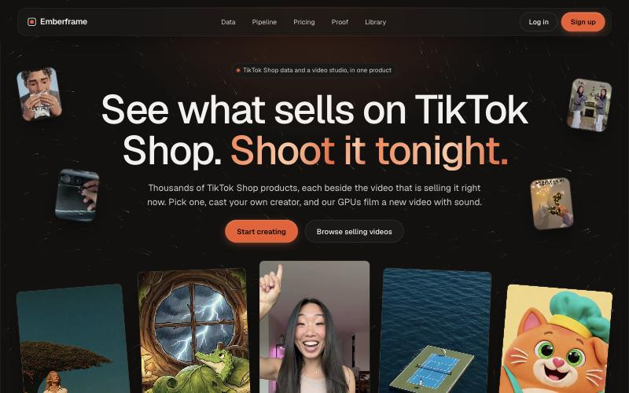
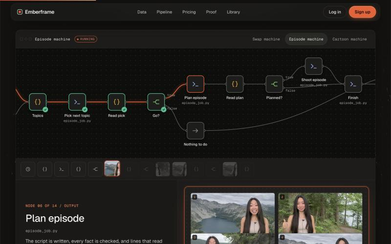
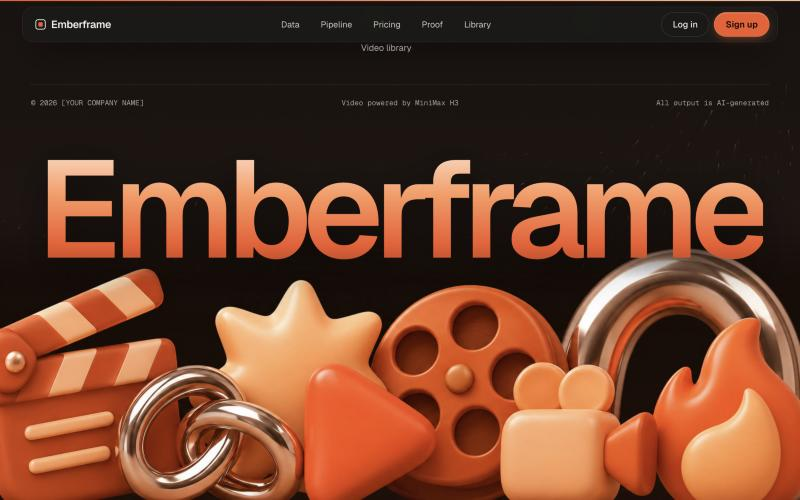

<div align="center">

# Emberframe

**See what sells on TikTok Shop. Shoot it tonight.**

TikTok Shop data and a video studio in one product: find a product that is already selling,
cast your own creator, and our GPUs film a new video with sound.

**[See it live](https://smammadov1994.github.io/EmberFrame/)** · [Video library](https://smammadov1994.github.io/EmberFrame/library.html)

[](https://smammadov1994.github.io/EmberFrame/)

</div>

---

## What this is

The marketing site and library for Emberframe, as a static prototype. Plain HTML, CSS and
JavaScript. No framework, no build step, no backend.

It shows three things:

1. **The data.** A live pull of trending TikTok Shop videos with views, 7-day units and creators.
2. **The pipeline.** Our real n8n workflows, animated node by node, with what each node produces.
3. **The proof.** Clips rendered on our own GPUs, including side-by-side swaps of the same room,
   product and movements with a different person.

## A run through the pipeline

An ember travels the wires of the actual workflow. Each node it reaches lights up, and the
panel underneath shows what that node made: settings, screening checks, start pictures, a voice
track, and finally the finished video.



The three workflows come from
[n8n-video-pipelines](https://github.com/smammadov1994/n8n-video-pipelines):

| Workflow | What it makes |
|---|---|
| **Swap machine** | Takes a selling product video and remakes it with your creator and one consistent voice |
| **Episode machine** | An AI presenter explains one question per episode, as a wide video and a vertical Short |
| **Cartoon machine** | Mango the cat teaches children one simple recipe per episode |

## Run it

```bash
python3 -m http.server 4175 --bind 127.0.0.1
```

Then open <http://127.0.0.1:4175/>. Any static file server works.

## The studio (Ember and the editor)

The studio is the screen you land on after signing in: **Ember**, a chat agent, on the left, and a
**video editor** on the right. It needs a small server, because it calls real models.

```bash
uv run server/ember.py
```

Then open <http://127.0.0.1:4180/studio.html>.

How the studio behaves, step by step, and the rules it enforces: [docs/STUDIO.md](docs/STUDIO.md).

What Ember can do, by chat or by its buttons:

- **Edit the cut:** trim, split, cut a range, reorder, captions, volume. You can also drag everything by hand; Ember sees what you change.
- **Clean up:** find the pauses and cut them out.
- **Captions** from the speech, burned in on export.
- **Listen and look:** transcribe any clip, or look at its frames, before deciding what to cut.
- **TikTok Shop:** search what is selling and bring videos in as references.
- **Film new shots** on our GPUs and **record voice lines**. The price is shown and you approve before anything renders.
- **Motion graphics with raea:** word-by-word captions timed to the speech, name tags, titles, end cards, wipes, whole ads. Ember writes the composition as code, checks it, looks at stills, renders it on this machine and puts the clip on the timeline.
- **Export** one MP4 with the AI-generated label written into the file, then **post**: download it yourself, or add it to the auto-post queue.

How it is put together:

- One model, one streaming loop and a set of tools. No router in front of the model.
- The editor's project is the shared state. You change it by dragging; Ember changes it through `edit_timeline`; every message carries a fresh picture of it.
- Anything that costs money or leaves the building goes through an approval you tap.
- Users never reach the GPU. The server is the only holder of the machine address and token, each user has their own folder, and a user can only stop their own render.
- Reference videos from other creators can be studied but not exported.

To give Ember its full brain, put a model key in `server/.env` (this file is not committed). Either works:

```bash
ANTHROPIC_API_KEY=your-key-here     # Claude (used first if both are set)
OPENAI_API_KEY=your-key-here        # OpenAI
# optional: EMBER_BRAIN=openai   EMBER_OPENAI_MODEL=gpt-6-luna   EMBER_MODEL=claude-opus-5-5
```

Without a key the studio still runs: the editor works fully by hand, and Ember follows a few plain
commands ("cut from 2 to 4", "clean it up", "add captions", "export").

## What is inside

| File | What it does |
|---|---|
| `index.html` | Landing page: hero reel, Shop data, pipeline, pricing, consistency, library teaser, questions, footer |
| `library.html` | The video library. Three free previews, the rest locked until sign up |
| `config.js` | **The one place for prices, plans, products and example clips** |
| `pipelines.js` | The three n8n workflows as node graphs (names, types, positions, connections) |
| `flows.js` | One example run per workflow: the nodes it passes through and what each one outputs |
| `app.js` | Accounts, sign up and log in, library lock and unlock, tiles, the workflow run animation |
| `motion.js` | Scroll reveals, the reel fan, the footer wordmark, pointer spotlight |
| `particles.js` | The ember streams behind the page |
| `styles.css` | Everything visual |
| `media/` | Rendered clips, Shop previews, workflow stage pictures and the footer art |
| `studio.html`, `studio.css`, `studio.js` | The studio screen: a menu bar (File, Edit, View, Tools, History, Help), Ember chat, library, preview, timeline, post step. A person has many projects; a new project stays in the workflow until it has a clip |
| `flow.js`, `flow.css` | The canvas, which is the studio's main screen: a node board you can pan and zoom. Files are media nodes; whatever is wired into the Final video node, in order, is the video. Wiring two nodes together offers what they can make (remake a selling video with an avatar, join clips, lay a voice). Workflow nodes (what to make, script, voice, film) produce new clips. Ember's edits show on the same board |
| `server/ember.py` | The studio's server: projects, Ember's tools and loop, export |
| `supabase/migrations/` | The data model for Supabase (Postgres): people, projects, library, the cut, chats, boards, jobs, exports, the ledger, with row level security. Not connected to the studio yet |
| `supabase/tests/test_schema.py` | Applies the migrations to a throwaway Postgres and checks the rules hold: `uv run supabase/tests/test_schema.py supabase/migrations` |
| `server/raea_tools.py` | Ember's three raea tools (`raea_docs`, `raea_files`, `raea`) and what Ember is told about them. Needs [raea](https://github.com/shinyobjectz/raea) installed (`~/.local/bin/raea`); without it the studio runs as before |

### Changing prices

Edit `config.js`. Nothing else holds a price.

```js
videoRate: 0.04,   // dollars per video second
imagePrice: 0.02,  // dollars per still image
plans: [ /* Pay as you go, Creator, Creator Pro */ ]
```

## How it is built

- **No dependencies.** Fonts (Geist and Geist Mono) are the only thing loaded from outside.
- **Progressive motion.** Every animation is an enhancement. With JavaScript off, or with
  reduced motion turned on, the page is fully visible and static.
- **Videos behave.** They autoplay muted, loop, show a poster until loaded and pause off screen.
  Click one for sound.
- **Works on a phone.** No sideways scroll at 375px, tap targets at least 44px tall.



## What is real and what is not

This is a prototype. Being straight about where the edges are:

| Part | State |
|---|---|
| Shop data on the page | Real, pulled from Kaiyros Discover on 2026-11-11. A snapshot, not a live feed |
| Rendered clips | Real output from our own pipelines |
| Workflow graphs and node outputs | Taken from the real workflow files and real intermediate pictures |
| Accounts | **A stub.** Sign up and log in are stored in your browser's `localStorage`. This is not real security and must be replaced before launch |
| Rendering from the site | Not connected. Nothing on the page starts a GPU |
| Payments | Not connected. Nothing is charged |
| Prices | Proposals, not tested |
| "Post to TikTok" step | Not built yet |

Text in square brackets, such as `[YOUR COMPANY NAME]` and `[YOUR REFUND POLICY]`, marks a
decision that is still open.

## Notes on content

- **AI disclosure.** Every clip we rendered is AI-generated and is labelled as such in the
  captions and the footer. In side-by-side swap clips, the right half is the AI-generated remake.
- **Swap clips.** The creators shown in the side-by-side clips agreed to this feature. A
  reference video guides structure only; we do not copy another creator's face, voice or words.
- **Library previews.** The clips under `media/kaiyros/` are 12-second previews of TikTok videos
  that belong to their original creators, shown with their handles. They are not ours and are
  not AI-generated.
- **Model.** Video is powered by MiniMax H3 (HyperFlow H3 Flash). Check the model licence before
  commercial use.
- **Name.** "Emberframe" is a working name.

---

<div align="center">

Built for the ones who would rather direct than render.

</div>
